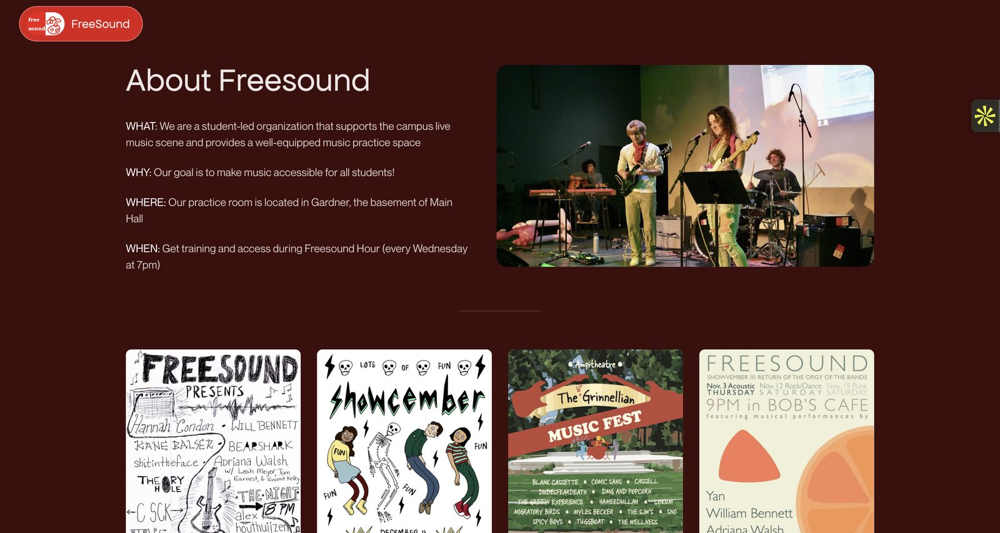

# Freesound

The website for Freesound, Grinnell College's student music group. Freesound has been putting on shows and running the practice room in Gardner since 1998.

**Live:** [freesound.us.reclaim.cloud](https://freesound.us.reclaim.cloud/)
**Write-up:** [jasonchigabatia.com/projects/freesound](https://jasonchigabatia.com/projects/freesound)



## What's on it

- About Freesound and the practice room
- Posters from past shows
- The managers, each as a spinning action figure

## Stack

React + Vite on the front end, a small Express server, hosted on Reclaim Cloud.

## Run it

```bash
npm install
npm run dev
```

## What's next

A pipeline where future managers can ask an AI bot to update the site ("add this event", "swap my photo") so it keeps going after I graduate.

Built by [Jason Chigabatia](https://jasonchigabatia.com).
